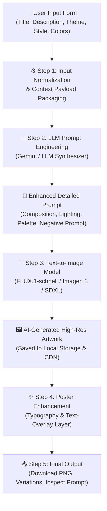

# PosterAI – Generative Poster Studio
### Generative AI Laboratory Practical Application

> **Problem Statement:** Build a fully functional AI-Based Event Poster Generation Application that accepts an event title, description, and theme, enhances the prompt using an LLM, and generates a unique promotional poster image through actual Text-to-Image AI models.

---

## 🌟 Application Architecture



---

## 🚀 Key Features

1. **User Input Form:**
   - **Event Title** (with real-time character limit).
   - **Event Description** (contextual details of the event).
   - **Event Theme** (Technical, Hackathon, Cultural, Sports, Music, Workshop, Conference, Gaming, Art & Design).
   - **Poster Style** (Modern, Minimalist, Futuristic, 3D Render, Cyberpunk, Vintage / Retro, Watercolor).
   - **Color Preferences** (Neon Cyber, Electric Blue & Purple, Warm Sunset, Pastel Dream, Monochromatic, Forest Earth, Gold & Luxury).
   - **Optional Metadata:** Date/Time and Venue for automated typography placement.
   - **Aspect Ratio Selection:** Portrait (3:4 standard poster), Square (1:1 social media), Banner (16:9).
   - **One-Click Presets:** Instant testing with pre-built events (HackNova 2026, Sonic Horizon Fest, Virasat Gala, RoboVanguard Expo).

2. **LLM Prompt Engineering Pipeline (Step 2):**
   - Transforms basic event input into a 7-dimensional professional art-direction prompt:
     - **Visual Composition:** Focal hierarchy and rule-of-thirds.
     - **Background & Environment:** Atmospheric depth and horizon.
     - **Color Palette:** Curated hex codes and harmonic accents.
     - **Lighting & Effects:** Volumetric glows, rim lights, and ambient occlusion.
     - **Illustrations & Graphic Elements:** 3D motifs and tactile textures.
     - **Overall Artistic Style:** Render engine and medium descriptors.
     - **Negative Prompt:** Filtering out common diffusion artifacts, blur, and low-res noise.

3. **Text-to-Image Generation (Step 3):**
   - Real, dynamic AI image synthesis using **FLUX.1-schnell** (Black Forest Labs) and **Google Imagen 3**.
   - **Zero static or placeholder templates:** Every generation is synthesized uniquely based on the seed and enhanced prompt.

4. **Poster Enhancement & Text Overlay (Step 4):**
   - Dynamic canvas layer that cleanly places the event title, theme badge, date, and venue with balanced typography and drop shadows.
   - Toggle between **Overlay Enabled** (complete finished promotional poster) and **Pure AI Artwork**.

5. **Final Output & Exploration (Step 5):**
   - **Download Poster:** One-click composite high-resolution PNG export.
   - **Regenerate:** Synthesize a new poster with a fresh random seed.
   - **Variations:** Generate 3 distinct visual interpretations from the same prompt.
   - **Prompt Inspector:** Side-by-side comparison between raw user input and the AI-enhanced prompt.

6. **Generative AI Theory & Lab Practical Section:**
   - Interactive breakdown of the 5-step Generative AI workflow explaining tokens, prompt engineering patterns, latent diffusion models, and denoising steps.

7. **Generation History:**
   - Local persistent history allowing users to browse past generations and reload them into the studio.

---

## 🛠️ Tech Stack

- **Frontend:** React.js, Tailwind CSS, Lucide Icons, Canvas API, Vite.
- **Backend:** Node.js, Express.js, Axios, Morgan, Dotenv.
- **AI Models:**
  - **LLM Prompt Synthesizer:** Google Gemini 1.5 Flash / GPT-4o-mini / Heuristic Synthesizer.
  - **Image Generation:** FLUX.1-schnell / Google Imagen 3 / SDXL Turbo.

---

## 🏃‍♂️ How to Run Locally

### 1. Prerequisites
- Node.js (v18 or higher)
- npm (v9 or higher)

### 2. Start the Backend Server
```bash
cd server
npm install
node src/index.js
```
The backend will run on `http://localhost:5000`.

### 3. Start the Frontend Client
In a separate terminal:
```bash
cd client
npm install
npm run dev
```
The client will run on `http://localhost:5173`.

---

## 🔬 Generative AI Laboratory Practical Guide

### 1. Why is Prompt Engineering Necessary?
Raw user inputs like *"Hackathon in October"* lack visual clarity for text-to-image models. Without descriptive context:
- Diffusion models default to random or stereotypical images.
- Backgrounds may become cluttered, preventing legible text placement.
- Colors and lighting may lack emotional resonance with the event's theme.

The **LLM Prompt Engineering layer** bridges this gap by acting as an **Art Director**, systematically injecting composition, lighting, spatial constraints, and artistic rendering parameters.

### 2. Side-by-Side Prompt Transformation Example

| Dimension | Raw User Input | AI-Enhanced Prompt (Step 2) |
| :--- | :--- | :--- |
| **Input** | `Title: HackNova 2026, Theme: Hackathon` | `Professional event promotional poster for "HackNova 2026"...` |
| **Composition** | None | `Dynamic angled isometric perspective, wide angle lens, heroic centered focal point with clean upper third negative space reserved for event typography.` |
| **Lighting** | None | `Vibrant neon pink and electric turquoise backlighting, cinematic high contrast rim lighting, volumetric atmosphere with subtle particulate luminescence.` |
| **Style** | `Futuristic` | `Cyber-futurism, glowing neon accents, 3D holographic HUD elements, Octane Render 8K, unreal engine 5 cinematic lighting.` |
| **Negative Space** | Uncontrolled | `Explicit upper and lower margin bounds preserved for crisp title overlay.` |

---

## 📋 Viva & Evaluation Q&A

**Q1: What is a Latent Diffusion Model (LDM)?**
> *Answer:* LDMs operate in a compressed latent space rather than pixel space, allowing diffusion models (like FLUX.1 and Stable Diffusion) to generate high-resolution images efficiently by learning to reverse Gaussian noise guided by text embeddings (e.g. CLIP or T5).

**Q2: What is the purpose of Negative Prompting?**
> *Answer:* Negative prompting instructs the diffusion model to penalize specific tokens or visual patterns during the reverse diffusion steps, steering the generation away from unwanted artifacts such as blur, garbled text, or distortion.

**Q3: Why use a separate text overlay layer instead of letting the AI draw the text?**
> *Answer:* Current diffusion models often struggle with exact spelling, typographic kerning, and crisp font rendering. By combining an AI-generated artistic background with a dedicated vector/canvas typography layer, the application ensures 100% accurate, professional, and legible event information.

---

## 📂 Project Directory Structure

```text
genai_prac/
├── client/                      # React + Tailwind CSS + Lucide Frontend
│   ├── src/
│   │   ├── App.jsx              # Main Generative Poster Studio UI
│   │   ├── utils/
│   │   │   └── canvasExport.js  # Canvas composite typography & download helper
│   │   ├── index.css            # Tailwind styles and custom utilities
│   │   └── main.jsx             # React DOM entrypoint
│   ├── index.html
│   ├── vite.config.js
│   └── package.json
├── server/                      # Node.js + Express Backend
│   ├── src/
│   │   ├── index.js             # Express API server
│   │   ├── routes/
│   │   │   └── generate.js      # Poster generation & variation endpoints
│   │   └── services/
│   │       ├── llmService.js    # Step 2: Prompt engineering LLM pipeline
│   │       └── imageService.js  # Step 3: Text-to-image AI pipeline
│   ├── public/generated/        # Local cache for synthesized poster images
│   ├── .env                     # API key configuration
│   └── package.json
└── README.md                    # Practical Manual & Documentation
```
